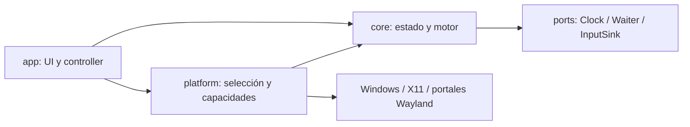

# Arquitectura Rust de NanoClick

Estado: diseño inicial para implementar. Las decisiones de plataforma y renderer requieren las pruebas P0 del plan. Fecha de consulta de fuentes: 2026-10-23.

## Alcance y decisiones

Aplicación local de escritorio, Rust edition 2024, Windows x86_64 MSVC y Linux x86_64 GNU. Rust estable fijado en `rust-toolchain.toml` al iniciar implementación; `rust-version` y `Cargo.lock` versionados. Windows 11 y Ubuntu 24.04 LTS serán referencias iniciales, sujetas a verificar requisitos de dependencias. No se promete soporte de Windows 10, ARM, musl o toda distribución sin validación.

UI recomendada: **egui/eframe**, tema propio y redibujado por eventos. Primer candidato de renderer: `glow` para minimizar dependencias y tamaño; comparar con `wgpu` en P0 y decidir con arranque, memoria, compatibilidad gráfica y accesibilidad. Activar explícitamente soporte X11, Wayland y AccessKit según plataforma. No fijar versiones de crates hasta resolver y probar un conjunto compatible.

| Opción | Evaluación para este producto |
|---|---|
| egui/eframe | Preferida: UI compacta en Rust, personalizable, integración de accesibilidad; validar lector de pantalla y reposo |
| Slint | Alternativa si el prototipo no alcanza calidad visual/accesibilidad; evaluar licencia y empaquetado antes de adoptarla |
| Iced | Alternativa Rust; requiere otra validación de accesibilidad y coste gráfico |
| Tauri | Viable para UI web, pero añade frontend y webview a una utilidad muy pequeña |
| Win32/GTK separados | Mayor coste de mantener dos interfaces y comportamiento consistente |

No se añade Tokio al motor. Un hilo de trabajo dedicado con espera cancelable basta. La integración D-Bus de Wayland puede necesitar un executor acotado en su adaptador; decidirlo en P0, sin bloquear UI ni crear un runtime por clic.

## Estructura y dependencias

Workspace con tres crates; subdivisión interna por módulos, evitando un crate por concepto:

```text
crates/
  core/src/       config, state, scheduler, engine, ports, metrics, error
  platform/src/   capabilities, windows, x11, wayland
  app/src/        main, controller, ui, theme, settings
tests/           flujos de integración y capturador de eventos
benches/         scheduler y agregación de métricas
```



`core` no conoce eframe, ventanas, D-Bus ni APIs del SO. `platform` implementa sus puertos. `app` compone dependencias y mantiene el borrador editable. Preferir dispatch estático en el bucle de clics; enum de backend o selección única al arrancar. Usar traits para aislamiento/testabilidad sin jerarquías genéricas innecesarias.

| Módulo | Responsabilidad y límite |
|---|---|
| config | `ClickConfig` validada: intervalo, botón y condición; sin textos de UI |
| state | Estados Idle, Preparing, Running, Stopping, Faulted; transiciones y razones de fin |
| scheduler | Deadlines monotónicos, decisión de omitir períodos vencidos, aritmética comprobada |
| engine | Worker propietario de configuración activa y contador; inicio, cancelación y cierre |
| ports | Contratos de reloj, espera cancelable e inyección; fakes para tests deterministas |
| metrics | Intentos, pares aceptados, fallos, períodos omitidos, retraso de deadline; muestras acotadas |
| capabilities | Reporte separado de inyección, atajos, permisos y motivo de indisponibilidad |
| windows/x11/wayland | Inyección, espera nativa y registro de atajos según backend |
| controller | Traduce acciones UI/atajos; aplica snapshots y rechaza eventos de sesión anteriores |
| ui/theme | Componentes visuales, tokens y navegación; todos los textos en inglés |
| settings | Preferencias versionadas; nunca reanudar automáticamente una sesión |

## Contratos de ejecución

- `ClickInterval`: entero de 1 a 999999 ms; representación interna `Duration`. Es un período objetivo entre comienzos de clics. Mostrar CPS como derivado, sin segundo valor editable.
- `StopCondition`: `UntilStopped` o `Count(NonZeroU64)`. Para V1, aceptar conteos 1..=999999, ampliables sin cambiar el tipo interno. Botón enum Left/Right/Middle.
- Inicio por atajo: primer clic inmediato después de preparación exitosa. Inicio manual: esperar tres segundos cancelables después de que el backend y sus permisos estén preparados; publicar el deadline monotónico en el snapshot. Después, siguientes según deadline monotónico. Cada clic es un par down/up. Cambios del borrador se aplican solo al próximo Start.
- Si el worker llega tarde, omitir slots vencidos y planificar el siguiente deadline futuro: nunca recuperar retraso con una ráfaga. Inyección secuencial, como máximo un par en vuelo.
- Estados: Idle → Preparing → Running → Stopping → Idle; preparación fallida o error de inyección → Faulted. El conteo completo vuelve a Idle con razón Completed. Para reintentar desde Faulted se exige limpieza y nueva preparación.
- Start repetido es idempotente; Stop y Shutdown también. Stop durante Preparing cancela permisos/preparación y no permite un inicio tardío. Cada ejecución tiene `run_id` para descartar respuestas obsoletas.
- La solicitud Stop activa una señal prioritaria y despierta la espera. Stop confirmado significa worker fuera del bucle y botón liberado o fallo de liberación reportado; no significa solo cambiar una bandera. Puede completarse un par ya iniciado antes del acuse.
- Canal de comandos acotado, sin bloqueo de la UI; Start se rechaza si está ocupado. Stop/Shutdown no pueden perderse por saturación: señal separada sincronizada con la espera. Worker publica último snapshot; coalescer progreso a 2 Hz máximo y despertar UI inmediatamente en transiciones. Estado terminal persistente, sin depender de una notificación que pueda perderse.
- Contar pares aceptados por el backend, no clics procesados por la aplicación objetivo. Windows permite verificar inserción en el stream; X11/Wayland no prueban recepción por el destino. Etiquetas y documentación deben reflejar esa diferencia.
- Fallo parcial: registrar botón potencialmente presionado, intentar liberarlo, detener y reportar el error. RAII libera handles, grabs y sesiones; `Drop` no sustituye un cierre explícito que pueda reportar errores. Un cierre forzado del proceso no permite garantizar limpieza.

## Plataformas y capacidades

| Entorno | Clics | Atajo | Criterio de aceptación |
|---|---|---|---|
| Windows | `SendInput`, dos INPUT en una llamada; verificar cantidad devuelta | `RegisterHotKey`, MOD_NOREPEAT y worker con MsgWaitForMultipleObjects/evento de apagado | Prueba real fuera de foco, conflicto y ejecución no elevada |
| Linux X11 | XTEST, comprobar extensión/conexión y flush; mapear botones 1/3/2 | Grab de tecla con modificadores, gestionar conflictos/layout | Sesión X11 real y destino de prueba |
| Linux Wayland | RemoteDesktop portal con permiso POINTER; primer candidato NotifyPointerButton | GlobalShortcuts portal, trigger realmente asignado | Sesión GNOME y KDE real, permisos aceptados/denegados/revocados |

La presencia de variables de entorno no demuestra capacidades: conectar al servicio y probar disponibilidad. En Wayland no usar XWayland como prueba de control de clientes Wayland nativos. Portales dependen del backend/compositor; matriz por entorno y versión, sin afirmar soporte universal. Si falta inyección, deshabilitar Start con explicación. Si falta atajo, permitir modo manual con Stop visible; no minimizar automáticamente ni presentar F6 como registrado.

Wayland: mantener sesiones autorizadas durante la ejecución; cerrar/revocar detiene el motor. La configuración del atajo puede quedar a cargo del escritorio; `preferred_trigger` no garantiza F6. Evaluar `ashpd`/`zbus` para cliente de portal; su elección y coste de llamadas quedan en P0. EIS es una alternativa posterior si el portal/mediciones lo requieren, no una dependencia inicial obligatoria. No usar root, `/dev/uinput` ni daemon privilegiado como requisito normal.

Windows: UIPI puede bloquear inyección hacia procesos de mayor integridad y no permite diagnosticar inequívocamente la causa usando solo el error de `SendInput`. Informar limitación sin elevar automáticamente. El doble INPUT reduce llamadas y evita intercalado dentro del par, pero requiere tratar inserción parcial.

## Rust y rendimiento

Ownership del estado activo en un solo hilo; valores pequeños por copia, referencias para lectura y clones justificados. `Result` tipado con `thiserror` en librerías; contexto en el límite del binario. Evitar `unwrap`, `expect` y panic en rutas de producción. `unsafe` solo en wrappers FFI mínimos de platform, con comentario SAFETY y pruebas; `forbid(unsafe_code)` en core/app.

Nada de asignaciones, formateo, IO de configuración ni log por clic en la ruta rápida estable. Buffers de eventos preconstruidos, contadores `u64` comprobados, métricas agregadas. Sin busy-wait por defecto, prioridad de tiempo real, afinidad fija ni polling de atajos. Esperas nativas interrumpibles: Windows timer/evento y Linux mecanismo equivalente validado en P0; reloj monotónico e inyección comparten worker. El coste de un backend D-Bus debe medirse, no ocultarse.

Build release portable: comparar `opt-level=3`, thin LTO y codegen-units=1 frente al perfil estándar; elegir por medición, no por intuición. No `target-cpu=native` en distribuciones. Conservar símbolos separados para diagnóstico. No adoptar panic=abort si rompe estrategia de liberación/diagnóstico. Reducir features y dependencias por target; no compilar todos los renderers por defecto.

## Fuentes primarias consultadas

- [eframe: features y renderers](https://docs.rs/eframe/latest/eframe/): soporte de AccessKit, X11/Wayland y diferencia de tamaño de glow/wgpu. No demuestra calidad de accesibilidad en esta aplicación.
- [SendInput](https://learn.microsoft.com/en-us/windows/win32/api/winuser/nf-winuser-sendinput): retorno, orden e integridad UIPI.
- [RemoteDesktop portal](https://flatpak.github.io/xdg-desktop-portal/docs/doc-org.freedesktop.portal.RemoteDesktop.html): ciclo de sesión, permiso POINTER y NotifyPointerButton.
- [GlobalShortcuts portal](https://flatpak.github.io/xdg-desktop-portal/docs/doc-org.freedesktop.portal.GlobalShortcuts.html): asignación, sesiones y eventos Activated.
- [XTEST](https://www.x.org/releases/current/doc/libXtst/xtestlib.html): extensión de entrada sintética. Verificar disponibilidad en ejecución.

Las fuentes respaldan APIs; el rendimiento, soporte en escritorios concretos y cumplimiento del producto requieren pruebas propias.
