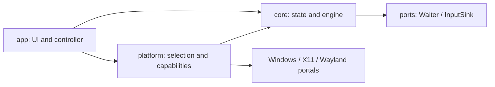

# NanoClick Rust architecture

Design specification; platform and renderer acceptance requires the plan's P0 evidence. See STATUS.md for implementation progress. Original source consultation date: 2026-10-23.

## Scope and decisions

Local desktop application, Rust edition 2024, Windows x86_64 MSVC and Linux x86_64 GNU. Pin stable Rust in `rust-toolchain.toml`; version `rust-version` and `Cargo.lock`. Windows 11 and Ubuntu 24.04 LTS are the initial references, subject to dependency requirements. Do not promise Windows 10, ARM, musl or every distribution without validation.

UI: **egui/eframe**, custom theme and event-driven repainting. `glow` is the provisional default to limit dependencies and size; compare it with `wgpu` using startup, memory, graphics compatibility and accessibility evidence. Explicitly enable X11, Wayland and AccessKit as appropriate. Resolve and test compatible crate versions before pinning them; the implemented selection is recorded in the manifests and lockfile.

| Option | Assessment for this product |
|---|---|
| egui/eframe | Preferred: compact customizable Rust UI and accessibility integration; validate screen readers and idle use |
| Slint | Alternative if the prototype misses visual/accessibility criteria; evaluate licensing and packaging before adoption |
| Iced | Rust alternative requiring separate accessibility and graphics-cost validation |
| Tauri | Viable for web UI, but adds a frontend and webview to a very small utility |
| Separate Win32/GTK UIs | Higher cost of maintaining two interfaces with consistent behavior |

Do not add Tokio to the engine. A dedicated worker with cancelable waiting is sufficient. Wayland D-Bus integration may require a bounded executor inside its adapter; do not block the UI or create a runtime per click.

## Structure and dependencies

Three-crate workspace with internal modules, rather than a crate per concept. The following is the logical module layout; implementations may combine closely related modules:

```text
crates/
  core/src/       config, state, scheduler, engine, ports, metrics, error
  platform/src/   capabilities, windows, x11, wayland
  app/src/        main, controller, ui, theme, settings
tests/           integration flows and event capture fixture
benches/         scheduler and metric aggregation
```



`core` knows nothing about eframe, windows, D-Bus or OS APIs. `platform` implements its ports. `app` composes dependencies and maintains the editable draft. Prefer static dispatch in the click loop, a backend enum or one-time selection at startup. Use traits for isolation/testability without unnecessary generic hierarchies.

| Module | Responsibility and boundary |
|---|---|
| config | Validated `ClickConfig`: interval, button and stop condition; no UI text |
| state | Idle, Preparing, Running, Stopping, Faulted; transitions and completion reasons |
| scheduler | Monotonic deadlines, skipped overdue periods and checked arithmetic |
| engine | Worker owns active configuration and count; Start, cancellation and shutdown |
| ports | Cancelable waiting and injection contracts; scheduler uses Duration offsets for deterministic arithmetic, execution uses monotonic Instant |
| metrics | Attempts, accepted pairs, failures, skipped periods and deadline lateness; bounded samples |
| capabilities | Separate reports for injection, shortcuts, permissions and unavailability reasons |
| windows/x11/wayland | Injection, native waiting and shortcut registration per backend |
| controller | Translates UI/shortcut actions, applies snapshots and rejects previous-session events |
| ui/theme | Visual components, tokens and navigation; all text in English |
| settings | Versioned preferences; never automatically resume a session |

## Execution contracts

- `ClickInterval`: integer 1..=999999 ms, represented internally as `Duration`. This is a target period between click starts. Show derived CPS without another editable value.
- `StopCondition`: `UntilStopped` or `Count(NonZeroU64)`. V1 accepts counts 1..=999999, extensible without changing the internal type. Button enum: Left/Right/Middle.
- Shortcut Start: immediate first click after successful preparation. Manual Start: a cancelable three-second wait after the backend and permissions are ready; publish its monotonic deadline in the snapshot. Subsequent clicks follow monotonic deadlines. Each click is a down/up pair. Draft changes apply only to the next Start.
- If the worker is late, skip expired slots and schedule the next future deadline; never catch up with a burst. Injection is sequential, with at most one pair in flight.
- States: Idle → Preparing → Running → Stopping → Idle; failed preparation or injection → Faulted. Completing the count returns to Idle with reason Completed. Retrying from Faulted requires cleanup and fresh preparation.
- Repeated Start is idempotent, as are Stop and Shutdown. Stop during Preparing cancels permission/preparation and prevents a late start. Every run has a `run_id` for rejecting stale responses.
- Stop sets a priority signal and wakes the waiter. Acknowledged Stop means the worker has left the loop and released the button or reported a release failure; changing a flag is insufficient. An already-started pair may complete before acknowledgement.
- Bounded commands without blocking the UI; reject Start while busy. Saturation cannot lose Stop/Shutdown: use a separate signal synchronized with waiting. Publish the latest snapshot, coalesce progress to at most 2 Hz, and wake the UI immediately on transitions. Retain terminal state independently of potentially lost notifications.
- Count pairs accepted by the backend, not clicks processed by the target application. Windows can verify insertion into the stream; X11/Wayland do not prove receipt by the target. Labels and documentation must reflect this difference.
- Partial failure: record a potentially pressed button, attempt release, stop and report the error. RAII releases handles, grabs and sessions; `Drop` does not replace explicit shutdown that can report errors. Forced process termination cannot guarantee cleanup.

## Platforms and capabilities

| Environment | Clicks | Shortcut | Acceptance criterion |
|---|---|---|---|
| Windows | `SendInput`, two INPUT records in one call; check returned count | `RegisterHotKey`, MOD_NOREPEAT and worker with MsgWaitForMultipleObjects/shutdown event | Actual outside-focus test, conflict and non-elevated execution |
| Linux X11 | XTEST, check extension/connection and request delivery; map buttons 1/3/2 | Key grab with modifiers; handle conflicts/layout | Actual X11 session and test target |
| Linux Wayland | RemoteDesktop portal with POINTER permission; initial transport NotifyPointerButton | GlobalShortcuts portal, actual assigned trigger | Actual GNOME and KDE sessions, accepted/denied/revoked permissions |

Environment variables do not establish capabilities: connect to the service and check availability. XWayland does not prove control of native Wayland clients. Portals depend on the backend/compositor; maintain a per-environment/version matrix without claiming universal support. Missing injection disables Start with an explanation. Missing shortcuts permit manual mode with visible Stop; do not minimize automatically or present F6 as registered.

Wayland: retain authorized sessions during a run; closure/revocation stops the engine. The desktop may control shortcut assignment; `preferred_trigger` does not guarantee F6. The implemented portal client uses `ashpd`/`zbus`; measure its call cost in P0. EIS is a later alternative if portals/measurements require it, not a mandatory initial dependency. Do not require root, `/dev/uinput` or a privileged daemon for normal use.

Windows: UIPI may block injection into higher-integrity processes, and `SendInput` errors alone cannot unambiguously identify that cause. Report the limitation without automatically elevating. Two INPUT records reduce calls and avoid interleaving within the pair, but partial insertion still requires handling.

## Rust and performance

A single thread owns active state; copy small values, borrow for reads and justify clones. Use typed `Result` errors with `thiserror` in libraries and context at the binary boundary. Avoid `unwrap`, `expect` and panic in production paths. Confine `unsafe` to minimal platform FFI wrappers with SAFETY comments and tests; `forbid(unsafe_code)` in core/app.

No allocations, formatting, configuration I/O or per-click logging in the stable fast path. Prebuild event buffers, use checked `u64` counters and aggregate metrics. No default busy waiting, real-time priority, fixed affinity or shortcut polling. Native interruptible waits: Windows timer/event and a Linux equivalent validated in P0; the monotonic clock and injection share a worker. Measure D-Bus backend costs instead of hiding them.

Portable release build: compare `opt-level=3`, thin LTO and codegen-units=1 against the standard profile; select by measurement. No distributed `target-cpu=native` builds. Retain separate diagnostic symbols. Do not adopt panic=abort if it breaks cleanup/diagnostic handling. Limit features and dependencies per target; do not compile all renderers by default.

## Primary sources consulted

- [eframe features and renderers](https://docs.rs/eframe/latest/eframe/): AccessKit, X11/Wayland support and glow/wgpu size differences. This does not establish accessibility quality in this application.
- [SendInput](https://learn.microsoft.com/en-us/windows/win32/api/winuser/nf-winuser-sendinput): return values, ordering and UIPI integrity.
- [RemoteDesktop portal](https://flatpak.github.io/xdg-desktop-portal/docs/doc-org.freedesktop.portal.RemoteDesktop.html): session lifecycle, POINTER permission and NotifyPointerButton.
- [GlobalShortcuts portal](https://flatpak.github.io/xdg-desktop-portal/docs/doc-org.freedesktop.portal.GlobalShortcuts.html): assignment, sessions and Activated events.
- [XTEST](https://www.x.org/releases/current/doc/libXtst/xtestlib.html): synthetic input extension. Check availability at runtime.

Sources support API contracts; performance, specific desktop support and product compliance require application evidence.

Worker wait implementation: `StdWaiter` on Linux, high-resolution one-shot timer plus per-run cancellation event on Windows. The scheduler rechecks monotonic deadlines after every wake. See [native wait evidence](../evidence/native-waiter.md) for ownership, lock ordering and pending native acceptance.
